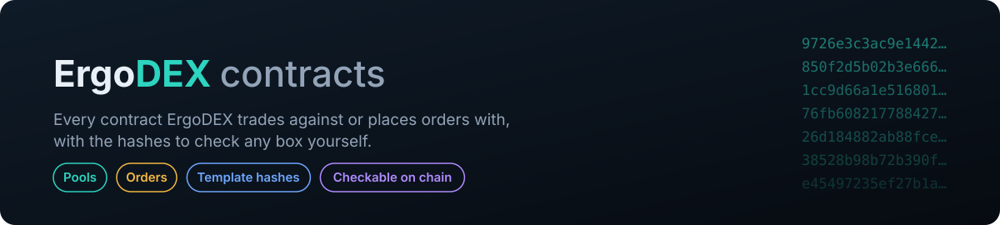

<div align="center">



</div>

Every smart contract [ErgoDEX](https://ergodex.io) trades against, places orders with or reads on the Ergo blockchain — **24 contracts, 14 of them live** — with the hashes you need to find and check any of their boxes yourself.

ErgoDEX is non-custodial and deploys no contracts of its own: swaps go through public pools, and orders are boxes under their authors’ contracts. Your wallet signs every transaction; funds in an order stay in its box until it is filled at your price or better, expires, or you cancel it.

**Contents:** [How to check](#how-to-check) · [Statuses](#statuses) · [Pools and orders a swap can take](#pools-and-orders-a-swap-can-take) · [Orders ErgoDEX places](#orders-ergodex-places) · [Earlier contracts](#earlier-contracts) · [Read for history](#read-for-history) · [Machine-readable](#machine-readable) · [Contact](#contact)

## How to check

A **template hash** identifies a contract’s code apart from its parameters: every pool or order of one kind shares it. Here it is BLAKE2b-256 of the ErgoTree template — the key an Ergo node indexes boxes by. List the live boxes of a contract on any node with the extra index enabled:

```sh
# Limit order v3 (Crux): open orders on chain
curl "$NODE/blockchain/box/unspent/byTemplateHash/9726e3c3ac9e14424b29b27f7fc8847b456606379cc217c9e532c3e66eacc222?limit=5"
```

The Ergo explorer API indexes the same templates by SHA-256; for the two V2 pool contracts both hashes are listed:

```sh
# V2 (Legacy) pools, ERG/token
curl "https://api.ergoplatform.com/api/v1/boxes/unspent/byErgoTreeTemplateHash/2dcc7830afe8f355b945850c60ff2b41fdb3e8ade07fde0a7c8a3ec498e8c3f6?limit=5"
```

The SigmaUSD bank and the V3 / Full range configuration are found by their **NFT** token id instead of a template.

## Statuses

| Status | Meaning |
|---|---|
| 🟢 Live | in use for new swaps or orders |
| 🟡 Open orders only | nothing new is placed; open orders are still filled |
| 🟠 Withdraw only | positions can be withdrawn, nothing else |
| ⚪ History and cancel | shown in history; open orders can be cancelled, not filled |
| ⚪ History | read only to show past trades |

## Pools and orders a swap can take

| Contract | Status | Hashes | Source |
|---|---|---|---|
| **V2 (Legacy) pool, ERG/token**<br><sub>Constant-product pool of ERG and one token. Its fee is stored in the pool box.</sub> | 🟢 Live | Template hash<br>`850f2d5b02b3e66612e5499953fe8dfe54b8c077a0bd85362b5c706ffebd2bae`<br>SHA-256 (explorer API)<br>`2dcc7830afe8f355b945850c60ff2b41fdb3e8ade07fde0a7c8a3ec498e8c3f6` | [Spectrum](https://github.com/spectrum-finance/ergo-dex) |
| **V2 (Legacy) pool, token/token**<br><sub>Constant-product pool of two tokens.</sub> | 🟢 Live | Template hash<br>`aea967ce41bbce4eb63471df4a7491699a51cdf77b749705c8a008cb98ea1537`<br>SHA-256 (explorer API)<br>`3c09deff3b5f49329149d18e02aab675ef6957bf6559a5c7dba817fee883fb3e` | [Spectrum](https://github.com/spectrum-finance/ergo-dex) |
| **V3 range (Crux concentrated liquidity)**<br><sub>One liquidity range of a V3 pool. Its script carries the hash of Crux’s CL validator and the NFT of the configuration it follows, here Crux’s pre-launch configuration on mainnet.</sub> | 🟢 Live | Template hash<br>`1cc9d66a1e516801683875d37e538fc008207df8b3b853be45c57a27e97a6318`<br>Validator hash<br>`70286f997a21187839b4902d464335eafb14c4c397f846ab0c12193b142fe67d`<br>Configuration NFT<br>`289c9c0e8a394769cf5b9622546e58b263d20dd2504eabdcaa01515bf149da8b` | [Crux](https://github.com/cruxfinance) |
| **Full range pool (Crux), ERG/token**<br><sub>Constant-product pool of ERG and one token on Crux’s contracts. It follows the same configuration NFT as V3.</sub> | 🟢 Live | Template hash<br>`26d184882ab88fce4b4b2149a75e9aef6bd5a515c89e7d76e6f29c1dbbca5632`<br>Configuration NFT<br>`289c9c0e8a394769cf5b9622546e58b263d20dd2504eabdcaa01515bf149da8b` | [Crux](https://github.com/cruxfinance) |
| **Full range pool (Crux), token/token**<br><sub>Constant-product pool of two tokens on Crux’s contracts, the same configuration.</sub> | 🟢 Live | Template hash<br>`32ab8321a95a9c84614f3b4dc24176cadb268283aaa506d2bf693e942a6aff4c`<br>Configuration NFT<br>`289c9c0e8a394769cf5b9622546e58b263d20dd2504eabdcaa01515bf149da8b` | [Crux](https://github.com/cruxfinance) |
| **Lithos pool, ERG/token**<br><sub>Lithos pool of ERG and one token.</sub> | 🟢 Live | Template hash<br>`76fb608217788427bc0ee0c4f7319982b618d98857ba5c1c8753b2c12ee4c139` | [Lithos](https://github.com/Lithos-Protocol/Lithos-Client) |
| **Lithos pool, token/token**<br><sub>Lithos pool of two tokens. It always trades alone.</sub> | 🟢 Live | Template hash<br>`4b8ced39b69eb50b2474e8399034111bb7be6c49055110cd0396f0fe1570055a` | [Lithos](https://github.com/Lithos-Protocol/Lithos-Client) |
| **Machina grid order, ERG/token**<br><sub>An open Machina order between ERG and a token. Smart Route can fill it at its own price.</sub> | 🟢 Live | Template hash<br>`38528b98b72b390f3c0354fc2d91663aa35a35e4341af3bb2ecfed60023b2195` | — |
| **Machina limit order, ERG/token**<br><sub>The limit form of the same order.</sub> | 🟢 Live | Template hash<br>`8bdcc173f9c0dd53f1c13de2cd5349ff5a30993deae31b9796e6bfacf604b21f` | — |
| **SigmaUSD bank**<br><sub>Mints and redeems SigUSD and SigRSV against ERG at the oracle’s price. The code finds it by its NFT rather than by a template.</sub> | 🟢 Live | Bank NFT<br>`7d672d1def471720ca5782fd6473e47e796d9ac0c138d9911346f118b2f6d9d9`<br>Oracle pool NFT<br>`011d3364de07e5a26f0c4eef0852cddb387039a921b7154ef3cab22c6eda887f` | [SigmaUSD](https://github.com/anon-real/sigma-usd) |

## Orders ErgoDEX places

| Contract | Status | Hashes | Source |
|---|---|---|---|
| **Limit order v3 (Crux)**<br><sub>Holds what you sell until it fills at your price, expires or you cancel it. ErgoDEX places limit orders, smart orders and DCA plans with it.</sub> | 🟢 Live | Template hash<br>`9726e3c3ac9e14424b29b27f7fc8847b456606379cc217c9e532c3e66eacc222` | [Crux](https://github.com/cruxfinance) |
| **Lithos sell order**<br><sub>ERG to a token through a Lithos pool, placed when Nautilus cannot sign the pool itself. An executor fills it against the pool.</sub> | 🟢 Live | Template hash<br>`e45497235ef27b1a4cfddff54ca218c534c43c7dad3356dd44513a311716f90e` | [Lithos](https://github.com/Lithos-Protocol/Lithos-Client) |
| **Lithos buy order**<br><sub>A token to ERG, the same way.</sub> | 🟢 Live | Template hash<br>`876bfd5f12369384a39574bb6f806d2312dc2996a8600d0496083d98433bab24` | [Lithos](https://github.com/Lithos-Protocol/Lithos-Client) |
| **Lithos token/token order**<br><sub>One token to another through a Lithos pool of two tokens.</sub> | 🟢 Live | Template hash<br>`fcbeb4fead6504861a3fb4febd475b820ccaef84a6c6bf223826fa585a3c8320` | [Lithos](https://github.com/Lithos-Protocol/Lithos-Client) |

## Earlier contracts

| Contract | Status | Hashes | Source |
|---|---|---|---|
| **V3 range on the earlier validator (Crux)**<br><sub>Ranges opened before Crux replaced the CL validator on 2026-11-10 keep the earlier one. They can be withdrawn; collecting fees and adjusting work on the current validator only.</sub> | 🟠 Withdraw only | Template hash<br>`1cc9d66a1e516801683875d37e538fc008207df8b3b853be45c57a27e97a6318`<br>Validator hash<br>`f5e47f921b32094c0b49f2ca09717b56cbbde827d9c68a2f8f1d2455da3f9c7b`<br>Configuration NFT<br>`289c9c0e8a394769cf5b9622546e58b263d20dd2504eabdcaa01515bf149da8b` | [Crux](https://github.com/cruxfinance) |
| **Limit order v2 (Crux)**<br><sub>The previous limit order, with its executor fee in a box of its own. Nothing new is placed; open orders are still filled and can be cancelled.</sub> | 🟡 Open orders only | Template hash<br>`724fc494188de2736168fdb62dc15575f6f7d3f8c11c71b978c6a6df274fca99`<br>Fee box template hash<br>`524cc90f7d29c86a1a24e5ed2c1a890110acc79d3db212c750ec5c2580df2f4f` | [Crux](https://github.com/cruxfinance) |
| **Limit order v1 (Crux)**<br><sub>The first limit order. Shown in history; open orders can be cancelled.</sub> | ⚪ History and cancel | Template hash<br>`b675082ed7c735ecba2e4aff702b0ad85b32894fa5a08cf497abb6387637916d` | [Crux](https://github.com/cruxfinance) |
| **DCA vault v2**<br><sub>A DCA plan of the previous version. No new plans; open plans are still filled and can be cancelled.</sub> | 🟡 Open orders only | Template hash<br>`13b6f3e70c6ef3aac5c013826d97328847ebb10bcca0956fc8bd0a32c5d52e85` | — |
| **DCA vault v1**<br><sub>The first DCA plan, the same way.</sub> | 🟡 Open orders only | Template hash<br>`b6bffe1ce7db827306f178101019692d1caf6b4f10b3478ed39699f226d20b9f` | — |
| **V2 swap orders**<br><sub>Orders against V2 pools placed through the earlier V2 interface, ERG to a token and back. ErgoDEX no longer places them; our executor fills the open ones.</sub> | 🟡 Open orders only | ERG to token<br>`0989e14076c1630db24dbb42387a4ae8a737e8c8ec3d486d5cc1abd4ac19f33e`<br>Token to ERG<br>`42f224f6c3bb898a0e7d46e863a57e69256bdae0c8ea62768c16d4c987a6d229` | [Spectrum](https://github.com/spectrum-finance/ergo-dex) |

## Read for history

| Contract | Status | Hashes | Source |
|---|---|---|---|
| **Machina grid order, token/token**<br><sub>A Machina order between two tokens.</sub> | ⚪ History | Template hash<br>`1411a5a6aa0013f954a615e2814ec17edd045dfbb38517319efee0a123f90955` | — |
| **Machina limit order, current build**<br><sub>The limit order as the current Machina tools compile it.</sub> | ⚪ History | Template hash<br>`cd3b6b5003514f260004d8836904ac1e6c0d111d7d8bb29c1230ff8fe8e5d4a9` | — |
| **Lithos liquidity orders**<br><sub>Orders that add liquidity to a Lithos pool or take it out.</sub> | ⚪ History | Deposit<br>`186e7b0eb6ac5a9e0d7c01f5b904f63448fce240ca2ec057fc2af7642e9fa071`<br>Withdraw<br>`a132ce7df8a72631c129cdc450a6212ab6b52c3ca5a1c6ab1adc97faa786b22b` | [Lithos](https://github.com/Lithos-Protocol/Lithos-Client) |
| **Swap orders that pay their owner**<br><sub>One-shot swap orders whose every fill pays the owner named in the order, read to show who traded.</sub> | ⚪ History | Template hash<br>`e100e9ea5ff57b618b37bac6ed4f666fb8e453c34d0ec1e2c38c0d51cbd54738`<br>Template hash<br>`a9ecdda4074fc04c5d407d54cc2a3d7f17b396bf3901a75c144349c88d707952` | — |

## Machine-readable

[`contracts.json`](contracts.json) holds the same list: name, description, status, every hash with its label, and the source.

```sh
curl -s https://raw.githubusercontent.com/ergodex/contracts/main/contracts.json | jq -r '.sections[].contracts[] | select(.status=="live") | .name'
```

## Contact

Questions, or a hash that does not match the chain: [hello@ergodex.io](mailto:hello@ergodex.io) · Telegram [t.me/ErgoDexio](https://t.me/ErgoDexio). Security reports: [SECURITY.md](SECURITY.md).

<sub>Updated 2026-11-16. The contracts belong to their authors and are published under their own licenses; this registry is CC0.</sub>
